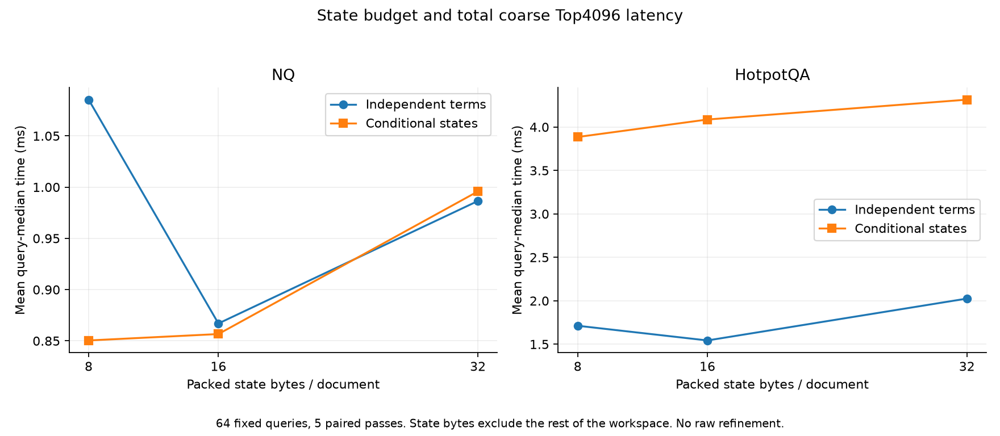
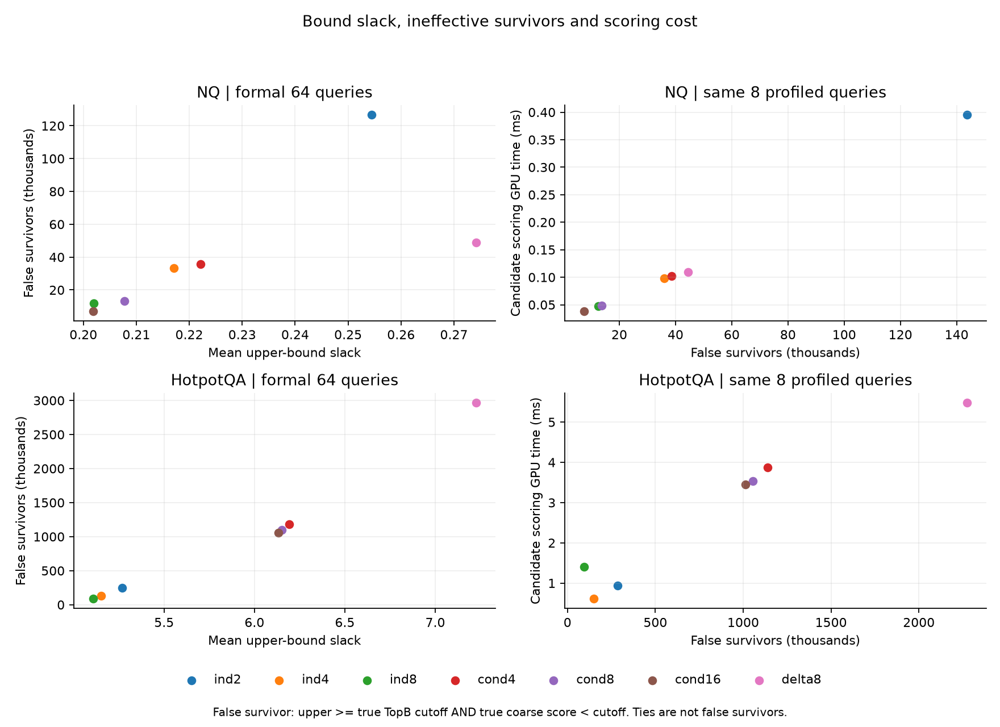
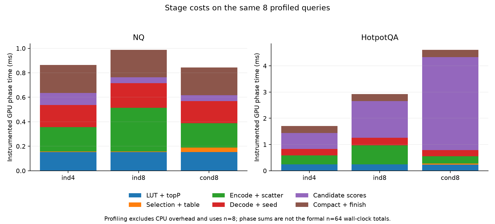

# Recomputed evidence

All intervals below resample the same observed query pairs (10,000 resamples,
seed 20261019). They describe query sampling, not machine/environment changes
or unseen-data generalization. Negative time change means faster.

| Full existing refinement pipeline: independent 4 vs 8 bins | Time change | Query bootstrap 95% interval | Faster / tied / slower queries |
|---|---:|---:|---:|
| NQ | −8.92% | [−9.46%, −8.38%] | 64 / 0 / 0 |
| HotpotQA | −20.39% | [−29.08%, −14.50%] | 63 / 0 / 1 |

64 fixed queries per corpus, five paired passes, one process session. Final
Top100 IDs matched in the sample. This is an own-control implementation result.

| Coarse-only pipeline: 24B hybrid vs independent 24B | Time change | Query bootstrap 95% interval | Faster / tied / slower queries |
|---|---:|---:|---:|
| NQ | +2.10% | [+2.00%, +2.21%] | 0 / 0 / 64 |
| HotpotQA | +17.26% | [+5.98%, +32.93%] | 23 / 0 / 41 |

Average the three process-session medians within each query, then resample
queries. These are still 64 queries, not 192 independent observations. Each
session's mean change was positive. The current hybrid route remains stopped.

## State budget and total coarse time

## Bound looseness and scoring cost

## Stage breakdown

The first figure uses 64-query formal wall-clock measurements. Profiled scoring
and stage breakdown use the same eight instrumented queries and exclude CPU
overhead. Their sums must not be presented as the full formal latency. State
bytes exclude shared indexes and other workspace; memory metrics and the
cached offline oracle are separately labeled in [summary.json](report/summary.json).

Reproduce with `python scripts/render_report.py --output run-output/report`.
The script verifies archived hashes and correctness records before rendering.
The raw measurements, including negative cases, remain in `evidence/`.
